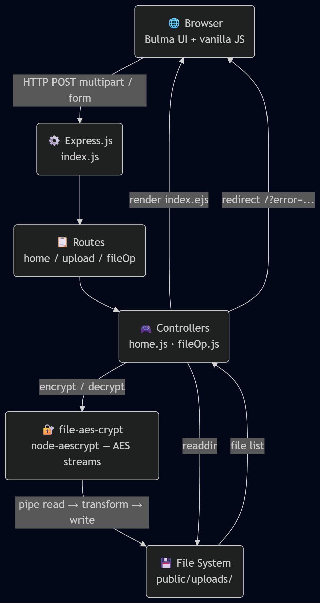
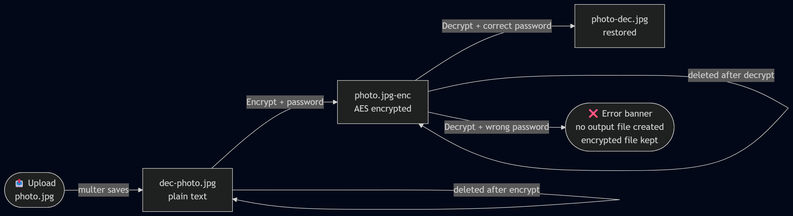

<div align="center">

# 🔐 SecureMe

**AES file encryption & decryption in your browser — no cloud, no accounts, just a password.**

[](https://nodejs.org)
[](https://expressjs.com)
[](LICENSE)

</div>

---

## What is SecureMe?

SecureMe is a lightweight web app that lets you upload files, encrypt them with a password-protected AES cipher, and decrypt them later — all from a clean browser UI. Files stay on your own server; nothing is sent to third parties.

---

## Features

| | |
|---|---|
| 📤 | Upload any file type |
| 🔒 | AES-encrypt with a password |
| 🔓 | Decrypt with the correct password |
| 🗑️ | Delete files from the server |
| 💾 | Download files directly |
| ⚠️ | Wrong-password error shown inline |
| 🚫 | Encrypt button disabled on already-encrypted files |
| 🚫 | Upload button disabled until a file is chosen |

---

## Tech Stack

| Layer | Technology |
|-------|-----------|
| Runtime | Node.js v14+ |
| Framework | Express.js 4 |
| Templates | EJS |
| File Uploads | Multer |
| Encryption | file-aes-crypt (AES via node-aescrypt) |
| Styling | Bulma CSS + Font Awesome 5 |
| Dev Server | nodemon |

---

## Getting Started

### Prerequisites

- Node.js v14 or higher
- npm

### Install & Run

```bash
git clone https://github.com/abhijeetsatpute/SecureMe.git
cd SecureMe
npm install
npm start
```

Open **[http://localhost](http://localhost)** in your browser.

> **Windows / port 80:** Port 80 requires elevated privileges on Windows. Either run your terminal as Administrator, or use a different port:
> ```bash
> $env:PORT=3000; npm start   # PowerShell
> PORT=3000 npm start         # bash / Git Bash
> ```
> Then open [http://localhost:3000](http://localhost:3000).

---

## Architecture

> **Note:** The `.php` files in the repo root are **legacy dead code** from an older PHP version of this app. The running application is 100% Node.js — no PHP interpreter is involved.

### System Architecture

<div align="center">
  
</div>

### File Lifecycle

<div align="center">
  
</div>

---

## How to Use

```
1. Pick a file  →  click Upload
2. Click Encrypt  →  enter a password  →  file is now locked
3. Click Decrypt  →  enter the same password  →  file is restored
4. Download or Delete as needed
```

> If you enter the **wrong password** on decryption, a red error banner appears and the original encrypted file is left untouched — no corrupt files are created.

### File Naming Convention

| Stage | Filename example |
|-------|-----------------|
| Uploaded | `dec-photo.jpg` |
| Encrypted | `photo.jpg-enc` |
| Decrypted | `photo-dec.jpg` |

The original file extension is always preserved after decryption.

---

## Project Structure

```
SecureMe/
├── controllers/
│   ├── fileOp.js       # Encrypt / decrypt / delete logic
│   └── home.js         # Reads uploads dir, passes error query param to view
├── routes/
│   ├── fileOp.js       # POST /enc  /dec  /del
│   ├── home.js         # GET /
│   └── upload.js       # POST /upload
├── utils/
│   └── file.js         # File deletion helper
├── views/
│   └── index.ejs       # Main page (upload form + file table + error banner)
├── public/
│   ├── main.js         # Client-side navbar burger / dropdown
│   └── uploads/        # Uploaded files (created at runtime)
└── index.js            # App entry point & middleware config
```

---

## API Routes

| Method | Route | Body params | Description |
|--------|-------|-------------|-------------|
| `GET` | `/` | — | Home — lists all uploaded files |
| `POST` | `/upload` | `file` (multipart) | Upload a file |
| `POST` | `/enc` | `fileName`, `encPwd` | Encrypt a file |
| `POST` | `/dec` | `fileName`, `decPwd` | Decrypt a file |
| `POST` | `/del` | `fileName` | Delete a file |

---

## Security Notes

> This app is designed for **local / trusted-network use**.

- No user authentication — anyone with server access can see all files. Add auth before any public deployment.
- Passwords are sent as plain form fields — run behind HTTPS in any non-local environment.
- Files are stored on disk with no access controls beyond the OS filesystem.

---

## License

ISC © [Abhijeet Satpute](https://github.com/abhijeetsatpute)
